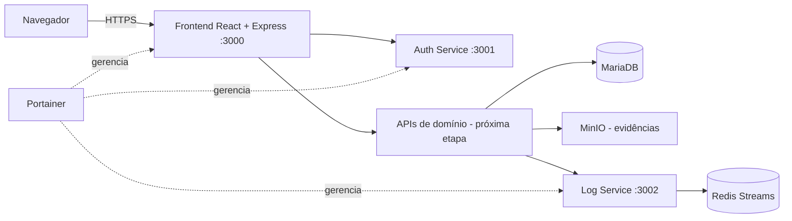

# TestFlow AI

Plataforma SaaS para organizar projetos, estruturar casos de teste e acompanhar execuções de APIs REST, com evolução planejada para geração assistida por inteligência artificial.

Projeto da disciplina **ISW055 — Introdução à Computação em Nuvem**, CST em Sistemas Inteligentes, FATEC Pompeia, semestre 2026.2. Orientação: Allan Lincoln Rodrigues Siriani.  
Professor: https://github.com/siriani

> **Estado desta entrega:** base visual e estrutural do MVP. A landing page e o servidor web estão implementados. As APIs de domínio, autenticação integrada à interface, execução real de requisições, auditoria de negócio e upload de evidências ainda precisam ser conectados e testados. Não apresentar esta versão como produto funcional completo.

## 1. Problema e proposta de valor

Pequenas equipes e profissionais que desenvolvem APIs REST repetem verificações manualmente, mantêm scripts dispersos e registram resultados em ferramentas diferentes. O TestFlow AI propõe reunir o ciclo de qualidade em um só lugar:

**Projeto → Caso de teste → Execução → Evidência**

A plataforma pretende reduzir o trabalho de preparação e documentação dos testes, mantendo histórico e rastreabilidade.

## 2. Público-alvo

- Desenvolvedores freelancers.
- Pequenas software houses.
- Equipes de desenvolvimento que não possuem uma equipe dedicada de QA.
- Profissionais que precisam repetir testes de integração e validar APIs REST.

A persona, os concorrentes, as hipóteses de preço e as métricas de negócio estão detalhados em [DOCUMENTACAO.md](DOCUMENTACAO.md). São hipóteses acadêmicas a validar, não resultados de pesquisa comprovados.

## 3. Escopo do MVP

### Incluído nesta base
- Identidade visual e landing page responsiva.
- Estrutura de frontend React, TypeScript e Vite.
- Servidor Node.js/Express com Helmet, rate limit básico, health check e entrega dos arquivos estáticos.
- Arquitetura planejada para MariaDB, serviço de autenticação, serviço de logs, Redis e MinIO.
- Migração de domínio com quatro tabelas relacionadas.
- Documentação de segurança, arquitetura, configuração e próximos passos.

### Próxima etapa de implementação
- APIs CRUD de projetos e casos de teste.
- APIs de execução e histórico.
- Autorização por papel e isolamento por proprietário no backend.
- Autenticação da interface com o auth-service.
- Auditoria de eventos de negócio.
- Upload e recuperação de evidências no MinIO.
- Testes automatizados, integração e validação em ambiente de homologação.
- Integração de IA e Stripe em etapas posteriores.

## 4. Papéis e permissões planejados

| Ação | Admin | Analista | Desenvolvedor |
|---|---:|---:|---:|
| Listar e visualizar projetos próprios | Sim | Sim | Sim |
| Criar/editar projetos próprios | Sim | Sim | Não |
| Listar e visualizar casos próprios | Sim | Sim | Sim |
| Criar/editar casos próprios | Sim | Sim | Não |
| Criar e consultar execuções próprias | Sim | Sim | Sim |
| Consultar e enviar evidências próprias | Sim | Sim | Sim |
| Consultar logs administrativos | Sim | Não | Não |

O papel `admin` não deve ignorar o isolamento de dados privados de outros usuários. Toda consulta e alteração deverá validar a propriedade no servidor. Uma tentativa de acessar um registro de outra conta deverá retornar `404` ou `403`, sem revelar dados.

**Importante:** esta matriz é a especificação de implementação. Não considerar as permissões entregues enquanto os middlewares e testes de autorização das APIs não estiverem concluídos.

## 5. Arquitetura



### Tecnologias
- Frontend: React 19, TypeScript, Vite e React Router.
- Backend web: Node.js 22 e Express.
- Autenticação planejada: serviço Node.js, JWT e bcrypt.
- Persistência: MariaDB.
- Auditoria planejada: serviço de logs e Redis Streams.
- Arquivos: MinIO.
- Containers: Docker e Docker Compose.
- Gerenciamento de implantação: Portainer.
- CI/CD: GitHub Actions e Docker Hub.

A infraestrutura mantém a rede Docker e os volumes existentes quando necessário para preservar os recursos já provisionados no ambiente acadêmico. Os nomes dos containers locais foram atualizados para TestFlow AI.

## 6. Modelo de dados

A migração `database/migration-v8-testflow.sql` cria:

- `projetos`: projetos pertencentes a um usuário.
- `casos_teste`: cenários vinculados ao projeto e ao mesmo proprietário.
- `execucoes`: histórico de execução vinculado ao caso, projeto e proprietário.
- `evidencias`: metadados e chave do objeto armazenado no MinIO, vinculados à execução.

As chaves estrangeiras compostas reforçam a consistência de propriedade entre os registros. A aplicação ainda precisa aplicar filtros de proprietário em todas as APIs; constraints não substituem autorização.

### Aplicação da migração
1. Fazer backup do banco utilizado pelo ambiente.
2. Confirmar que `usuarios.id` é compatível (`INT`) e que `usuarios` usa InnoDB.
3. Executar `database/migration-v8-testflow.sql` uma única vez no banco correto.
4. Conferir a criação das quatro tabelas.
5. Não executar em produção sem backup e sem confirmar o banco/stack de destino.

O arquivo `database/seed-testflow.sql` é um guia de seed opcional. Ele não cria contas fictícias nem insere dados automaticamente.

## 7. Execução local

Requisitos: Node.js 22+, npm e Docker Desktop (para a stack completa).

```bash
cp .env.example .env
```

Preencha `.env` com credenciais locais fortes. Não reutilize credenciais de produção.

```bash
npm ci
npm --prefix frontend ci
npm --prefix frontend run build
npm start
```

A aplicação web utiliza a porta `3000`. Verificação de saúde:

```bash
curl http://localhost:3000/health
```

O endpoint `/api/status` informa explicitamente que as APIs de domínio ainda estão pendentes.

Para subir a stack Docker local, revise primeiro as variáveis e os volumes em `docker-compose.yml`. Não execute `docker compose down -v` em ambientes que contenham dados importantes.

## 8. Configuração de implantação

- O arquivo `docker-compose.portainer.yml` mantém a porta externa previamente utilizada (`8211:3000`) e a rede existente.
- As imagens foram renomeadas para `joicesoato/testflow-ai`, `joicesoato/testflow-ai-auth` e `joicesoato/testflow-ai-log`.
- Antes do deploy, criar/verificar os três repositórios no Docker Hub e conferir se as imagens publicadas são públicas ou se o Portainer possui credenciais para acessá-las.
- Configurar as variáveis do Portainer usando os valores já existentes e válidos no ambiente.
- Não alterar domínio, porta, volumes ou credenciais sem validar com o responsável pela infraestrutura.
- O deploy deve ocorrer somente depois da revisão do workflow, migração, variáveis e backup.

## 9. Segurança

Consulte [SECURITY.md](SECURITY.md) para o checklist de segurança e limites conhecidos desta versão. O resultado das verificações realizadas e pendentes está em [VALIDACAO.md](VALIDACAO.md).

Regras essenciais:
- Nunca versionar `.env`, tokens, senhas, chaves JWT, credenciais MinIO ou segredos Stripe.
- Utilizar HTTPS no ambiente publicado.
- Gerar segredos longos, aleatórios e diferentes por ambiente.
- Validar e autorizar toda operação no backend.
- Aplicar isolamento por `usuario_id` em consultas, alterações e exclusões.
- Validar método, URL, tamanho e conteúdo dos arquivos antes de executar requisições ou fazer upload.
- Proteger execução HTTP contra SSRF, redirecionamentos maliciosos, acesso a metadados e redes privadas.
- Registrar eventos sem incluir senhas, tokens, cookies ou conteúdo sensível.
- Fazer backup antes de qualquer migração.

## 10. CI/CD

O workflow em `.github/workflows/ci-cd.yml` prevê build/testes, publicação das imagens e webhook opcional do Portainer. Para funcionar, configure no GitHub Actions os secrets necessários, especialmente `DOCKERHUB_USERNAME`, `DOCKERHUB_TOKEN` e, se utilizado, `PORTAINER_WEBHOOK`.

O workflow precisa ser validado em execução real no GitHub Actions. A existência do YAML não comprova que o deploy foi realizado.

## 11. Critérios de aceite antes de considerar o SaaS funcional

- [ ] Build de frontend e containers aprovado.
- [ ] Migração aplicada com backup e conferência do schema.
- [ ] Cadastro, login e recuperação de senha testados.
- [ ] CRUD de projetos e casos testado.
- [ ] Execução de API com timeout, limites e proteção SSRF testada.
- [ ] 3 papéis testados com respostas `403` nas ações proibidas.
- [ ] Isolamento entre dois usuários testado em leitura, edição e exclusão.
- [ ] Eventos de auditoria com autor e data/hora conferidos.
- [ ] Upload e recuperação de evidências no MinIO testados.
- [ ] Landing pública acessível sem login.
- [ ] Stack Portainer saudável e URL pública validada.
- [ ] Prints de evidência e issue de entrega publicados.

## 12. Licença e uso acadêmico

Projeto acadêmico desenvolvido para a disciplina ISW055 — FATEC, semestre 2026.2.
